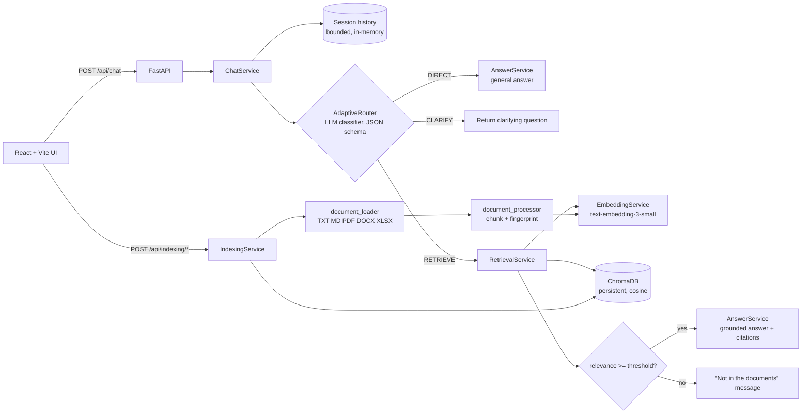

# VPRO Skills — Adaptive RAG Assistant

An educational **Adaptive Retrieval-Augmented Generation** application: a FastAPI backend that decides, for every question, whether to answer directly, search the course documents, or ask a clarifying question — and a React dashboard that shows that decision, the evidence used, and the state of the vector index.

> **Cost notice:** chat and indexing call the OpenAI API, which is billed per token. Indexing the bundled sample documents (~37 chunks) costs a fraction of a cent; unchanged files are never re-embedded.

---

## 1. Adaptive RAG in simple English

A basic RAG system *always* searches its documents before answering — even for "Hello". Adaptive RAG first asks **"what kind of question is this?"** and then picks the cheapest strategy that can answer it well:

| Route | Used for | What happens | Sources shown |
|---|---|---|---|
| **DIRECT** | Greetings, small talk, general questions not tied to the documents | The LLM answers immediately. **No vector search.** | None |
| **RETRIEVE** | Questions about the course notes / indexed documents | Embed the question → search ChromaDB → keep only chunks above the relevance threshold → LLM answers **only** from those chunks, with citations | Relevant chunks with scores |
| **CLARIFY** | Ambiguous questions ("Explain it.") that history doesn't resolve | Ask one short follow-up question. **No retrieval.** | None |

If RETRIEVE finds nothing relevant enough, the assistant says so instead of inventing an answer — and it does not call the LLM at all in that case.

## 2. Architecture



**Request flow for RETRIEVE:** classifier (1 LLM call, also produces a standalone search query using chat history) → 1 embedding call → Chroma top-k → relevance gate → answer (1 LLM call).
**DIRECT:** 2 LLM calls (pure greetings like "Hi" skip the classifier: 1 call). **CLARIFY:** 1 LLM call.

## 3. Directory structure

```
adaptive/
├── README.md
├── .gitignore
├── requirements.txt            # pinned backend + test dependencies
├── start.sh / start.bat        # one-command setup + launch
├── backend/
│   ├── .env.example            # copy to .env and add OPENAI_API_KEY
│   ├── main.py                 # FastAPI app, CORS, error handlers
│   ├── config.py               # all settings (pydantic-settings)
│   ├── dependencies.py         # service wiring (overridable in tests)
│   ├── pytest.ini
│   ├── api/                    # thin route modules
│   │   ├── health.py  chat.py  documents.py  indexing.py
│   ├── schemas/                # Pydantic request/response models
│   │   ├── chat.py  documents.py  indexing.py  common.py
│   ├── services/               # business logic
│   │   ├── adaptive_router.py      # DIRECT / RETRIEVE / CLARIFY classifier
│   │   ├── chat_service.py         # orchestrates route → retrieve → answer
│   │   ├── session_store.py        # bounded per-session history
│   │   ├── openai_service.py       # SDK wrapper + error translation
│   │   ├── embedding_service.py
│   │   ├── chroma_service.py       # persistent vector store
│   │   ├── document_loader.py      # text extraction per format
│   │   ├── document_processor.py   # chunking, fingerprints, chunk IDs
│   │   ├── retrieval_service.py    # vector search + relevance gate
│   │   ├── answer_service.py       # prompts for DIRECT / grounded answers
│   │   └── indexing_service.py     # idempotent index / reindex
│   ├── data/
│   │   ├── sample_documents/   # generated: .txt .md .docx .pdf .xlsx
│   │   └── sample_questions.json
│   ├── scripts/
│   │   ├── create_sample_files.py
│   │   └── index_documents.py
│   ├── storage/                # ChromaDB + last indexing result (git-ignored)
│   └── tests/                  # 68 offline tests + 1 optional live test
└── frontend/
    ├── package.json  vite.config.js  index.html  .env.example
    ├── public/logo.png         # VPRO Skills logo
    └── src/
        ├── main.jsx  App.jsx
        ├── api/client.js       # the only place that calls fetch
        ├── hooks/useChat.js  useBackendStatus.js
        ├── components/         # Header, Sidebar, ChatWindow, ChatMessage, ChatInput,
        │                       # RouteBadge, SourcePanel, SampleQuestions, StatusCard,
        │                       # LoadingIndicator, OverviewPanel, DocumentsPanel, IndexingPanel
        ├── styles/             # global, layout, components, chat
        └── utils/formatters.js
```

## 4. Prerequisites

- **Python 3.10–3.13** (tested with 3.11.15)
- **Node.js 20.19+ or 22.12+** (Vite 8 requirement; tested with 20.20.2) and npm
- An **OpenAI API key** for chat and indexing. Without one, the UI, health checks, document listing and all offline tests still work.

## 5. Quick start

```bash
cd RAGS/adaptive
bash start.sh              # macOS / Linux
# start.bat                # Windows (opens backend + frontend in two windows)
```

`start.sh` checks Python/Node → creates `.venv` → installs Python deps (only when `requirements.txt` changed) → generates any missing sample documents → `npm ci` (only when needed) → creates `backend/.env` and `frontend/.env` from the examples **only if they don't exist** → runs backend tests → builds the frontend → starts both servers. It stops at the first failure and prints the fix.

Then:

1. Put your key in `backend/.env` (`OPENAI_API_KEY=sk-...`) and re-run `bash start.sh --skip-checks` (backend reads `.env` at startup).
2. Open **http://localhost:5173** → **Indexing Controls** → **Index Documents**.
3. Ask questions.

**Stop:** press **Ctrl+C** in the `start.sh` terminal — it stops both servers. (`--skip-checks` skips tests and the build for faster restarts.)

## 6. Manual setup (separate terminals)

```bash
# --- one-time setup (from RAGS/adaptive) ---
python3.11 -m venv .venv
source .venv/bin/activate                 # Windows: .venv\Scripts\activate
pip install -r requirements.txt
cp backend/.env.example backend/.env      # then edit OPENAI_API_KEY
cp frontend/.env.example frontend/.env
python backend/scripts/create_sample_files.py          # add --force to regenerate
python backend/scripts/index_documents.py              # add --reindex for a full refresh
(cd frontend && npm ci)

# --- terminal 1: backend ---
source .venv/bin/activate
uvicorn main:app --app-dir backend --host 127.0.0.1 --port 8000 --reload

# --- terminal 2: frontend ---
cd frontend && npm run dev

# --- checks ---
(cd backend && ../.venv/bin/python -m pytest)          # offline tests
(cd backend && ../.venv/bin/python -m pytest -m live)  # optional real-OpenAI smoke test
(cd frontend && npm run build)                         # production bundle → frontend/dist
```

- Frontend: http://localhost:5173 · Backend: http://127.0.0.1:8000 · Interactive API docs: http://127.0.0.1:8000/docs

## 7. Configuration (`backend/.env`)

| Variable | Default | Meaning |
|---|---|---|
| `OPENAI_API_KEY` | *(empty)* | Required for chat and indexing. Never logged or returned. |
| `OPENAI_CHAT_MODEL` | `gpt-4.1-mini` | Router + answer model |
| `OPENAI_EMBEDDING_MODEL` | `text-embedding-3-small` | Changing it re-embeds everything on next index |
| `CHROMA_PERSIST_DIRECTORY` | `./storage/chroma` | Relative to `backend/` |
| `CHROMA_COLLECTION_NAME` | `vpro_adaptive_rag` | |
| `CHUNK_SIZE` / `CHUNK_OVERLAP` | `800` / `120` | Characters. Changing them re-chunks on next index |
| `TOP_K` | `5` | Chunks returned by vector search |
| `RELEVANCE_THRESHOLD` | `0.35` | Minimum cosine similarity (0–1) for a chunk to be used |
| `ANSWER_TEMPERATURE` | `0.2` | Answer generation (router always uses 0.0) |
| `MAX_HISTORY_TURNS` | `6` | Question/answer pairs remembered per session |
| `FRONTEND_ORIGIN` | `http://localhost:5173` | CORS origin(s); comma-separate several |
| `API_HOST` / `API_PORT` | `127.0.0.1` / `8000` | Used by `start.sh`, `start.bat`, `python backend/main.py` |
| `LOG_LEVEL` | `INFO` | |

Frontend: `frontend/.env` → `VITE_API_BASE_URL=http://127.0.0.1:8000`. If you change `API_PORT`, update this too. Never put secrets in `VITE_*` variables — they are shipped to the browser.

## 8. Sample documents

`backend/scripts/create_sample_files.py` writes five real, readable files (content lives in the script, timestamps are pinned, so output is deterministic):

| File | Content |
|---|---|
| `rag_fundamentals.txt` | What RAG is, indexing vs retrieval, embeddings, chunks, advantages, limitations |
| `adaptive_rag_guide.md` | Adaptive RAG, the three routes, classification, relevance checks, example scenarios |
| `hybrid_vs_advanced_rag.docx` | Hybrid vs Advanced RAG, sparse vs dense, query rewriting, reranking, comparison table |
| `rag_course_faq.pdf` | 12 Q&As on RAG, Adaptive/Hybrid RAG, ChromaDB, embeddings, OpenAI |
| `rag_concepts.xlsx` | Sheet `Concepts` with columns Concept / Definition / Example, 14 rows |

`backend/data/sample_questions.json` groups example questions by expected route, plus *borderline* and *out-of-scope* sets. The UI loads them from `GET /api/sample-questions`.

## 9. Indexing

- **Index** (`POST /api/indexing/index`) is incremental. Each file's *fingerprint* is a hash of its extracted text + chunk size + overlap + embedding model. Unchanged files are skipped with **zero OpenAI calls**, so repeated runs are idempotent. New or modified files are re-embedded.
- **Reindex** (`POST /api/indexing/reindex`) re-embeds every file and also removes chunks of files that were **deleted** from the folder.
- Both modes remove chunks of files that became empty or unreadable.
- **Safe updates:** for each file, new chunks are embedded first, then upserted, and only then are the file's old chunks deleted. If embedding fails (network, quota), the previous chunks stay intact and the file is retried on the next run.
- Chunk IDs are `<sha256(filename)[:12]>-<fingerprint[:12]>-<index>`: stable, unique, and they change whenever the content changes.
- Only one indexing run can write at a time; a concurrent request gets HTTP 409.
- Unsupported files (e.g. `.pptx`) are reported as skipped. Corrupt files are reported as errors and don't stop the other files.
- The last result is saved to `backend/storage/last_indexing_result.json` and survives restarts.

**ChromaDB persistence:** `backend/storage/chroma/` (cosine distance; `relevance = 1 − distance`). Delete that folder to start over.

## 10. API reference

All errors share one shape: `{"error": {"code": "...", "message": "..."}}`.

| Method & path | Purpose |
|---|---|
| `GET /api/health` | App status, OpenAI configured (boolean only), models, vector store status |
| `GET /api/indexing/status` | Collection, document & chunk counts, `is_indexing`, last result |
| `POST /api/indexing/index` | Incremental index |
| `POST /api/indexing/reindex` | Full refresh, removes stale chunks |
| `GET /api/documents` | Files on disk + indexed sources with chunk counts |
| `GET /api/sample-questions` | Example questions by expected route |
| `POST /api/chat` | Ask a question |
| `DELETE /api/chat/sessions/{session_id}` | Forget a session's history (used by "New Chat") |

**Chat request**

```json
{ "question": "What is ChromaDB according to the sample documents?", "session_id": "3f1c2a9e-5b7d-4e8f-9a0b-1c2d3e4f5a6b" }
```

`question`: 1–2000 chars, not blank. `session_id`: optional, `[A-Za-z0-9_-]{8,64}`. The server creates one if it's missing. History is kept **server-side** per session (bounded, expires after 2 h idle, never shared between sessions or persisted).

**Chat response** (RETRIEVE, abridged)

```json
{
  "answer": "ChromaDB is an open-source vector database ... [1]",
  "route": "RETRIEVE",
  "reason": "The user asks what the sample documents say about ChromaDB.",
  "session_id": "3f1c2a9e-...",
  "sources": [
    { "source": "rag_course_faq.pdf", "chunk_id": "9c1e...-0003", "snippet": "Q6. What is ChromaDB? ...",
      "relevance": 0.61, "chunk_index": 3, "total_chunks": 5, "page": 1, "sheet": null, "row": null }
  ],
  "retrieval_performed": true,
  "retrieval_count": 5,
  "relevance_score": 0.61,
  "relevance_threshold": 0.35,
  "grounded": true,
  "classifier_fallback": false
}
```

- `relevance_score` is the highest **cosine similarity** among retrieved chunks. It is a similarity measure, not a calibrated confidence, and it is `null` when no retrieval ran. No confidence values are invented.
- `retrieval_count` = chunks returned by the search; `sources` = only those above the threshold.
- `grounded` is `true` only when the answer was generated from document context.

**Status codes:** `422` invalid input · `409` indexing already running · `429` OpenAI rate limit/quota · `502` OpenAI auth/model/API error · `503` key not configured or OpenAI unreachable · `504` OpenAI timeout · `500` unexpected (details only in server logs).

```bash
curl -s http://127.0.0.1:8000/api/health
curl -s -X POST http://127.0.0.1:8000/api/indexing/index
curl -s -X POST http://127.0.0.1:8000/api/chat -H 'Content-Type: application/json' \
     -d '{"question":"Explain Adaptive RAG from the course notes."}'
```

## 11. Using the frontend

- **Header:** logo, backend connection, index status, and an API-key warning when the key is missing.
- **Sidebar:** *New Chat* (clears the conversation and the server-side history), *Chat*, *Overview* (system status + route explanations), *Sample Questions*, *Indexed Documents*, *Indexing Controls*. On tablets it collapses to icons; on phones it's a drawer opened from the ☰ button (Esc or the backdrop closes it).
- **Chat:** Enter sends, Shift+Enter adds a newline. Send is disabled while a request is pending (no duplicate submissions); responses from superseded requests are discarded. Each answer shows its **route badge**, **why that route was chosen**, retrieval stats, a **Copy** button and, for RETRIEVE, expandable **source cards** (file, snippet, relevance, page/sheet/row/chunk). Failed requests show the error with a **Retry** button.

## 12. How the router works

`services/adaptive_router.py` sends the classifier the question, up to `MAX_HISTORY_TURNS` previous exchanges, and the names of the indexed documents. It requires a JSON reply validated by the `ClassifierOutput` Pydantic model: `route`, `reason`, `clarifying_question` (required for CLARIFY), and `search_query` (a standalone query with pronouns resolved from history, used for retrieval).

- **Invalid classifier output → documented fallback: RETRIEVE.** Malformed JSON, an unknown route, a missing reason, or CLARIFY without a question all fall back to RETRIEVE, flagged as `classifier_fallback: true`. RETRIEVE is the safe choice because the relevance gate means a misroute can only end in an honest "not in the documents" reply, never an ungrounded answer.
- **API failures are not masked.** If OpenAI itself fails, the request fails with a clear error. No answer is fabricated.
- Classifier output is only data. It is never executed as code, SQL, shell or a tool call.
- A tiny exact-match list of pure greetings ("hi", "thanks", ...) skips the classifier to save a call. Everything else is classified by the LLM; there is no keyword router.

## 13. Questions to try

| Expected route | Question |
|---|---|
| DIRECT | Hi, how are you? · What is RAG in simple words? |
| RETRIEVE | Explain Adaptive RAG from the course notes. · What is the difference between Hybrid RAG and Advanced RAG in our documents? · What is ChromaDB according to the sample documents? |
| CLARIFY (new chat) | Explain it. · What about the second one? · Compare these two. |
| Borderline | What are embeddings? (DIRECT or RETRIEVE are both reasonable) |
| Out of scope | What is the capital of France according to our course notes? → RETRIEVE, then "not found" |

These are *expected* routes. The classifier decides each one live, and the UI always shows the route actually taken. Try follow-ups too: after asking about Hybrid vs Advanced RAG, "What about the second one?" should resolve from history instead of asking for clarification.

## 14. Tests

```bash
cd backend
../.venv/bin/python -m pytest          # 68 offline tests, no network, ~3 s
../.venv/bin/python -m pytest -m live  # optional: real OpenAI smoke test (indexes into a temp dir)
```

The offline suite uses a fake OpenAI service (deterministic bag-of-words embeddings, scripted replies) and a real ChromaDB in a temp directory. It covers health, request validation, all three routes, classifier fallback, retrieval skipped/executed, empty index, low relevance, grounded prompts, bounded and isolated history, error mapping (503/429/500 without leaking internals), every document format, unsupported and empty files, chunking, idempotent indexing, modified/deleted files, embedding failures preserving old chunks, concurrent-run rejection, and state persistence.

## 15. Troubleshooting

| Symptom | Fix |
|---|---|
| Banner "API key is not configured" | Set `OPENAI_API_KEY` in `backend/.env`, restart the backend |
| "OpenAI rejected the API key" (502) | Key is wrong or revoked |
| "rate limit or quota exceeded" (429) | Wait, or check billing at platform.openai.com |
| "Backend offline" in the UI | Backend not running, or `VITE_API_BASE_URL` doesn't match `API_HOST:API_PORT` |
| CORS errors in the browser console | Add the exact UI origin to `FRONTEND_ORIGIN` (e.g. `http://127.0.0.1:5173`) |
| RETRIEVE always says "not found" | Index first; or lower `RELEVANCE_THRESHOLD` slightly (e.g. 0.30) |
| "No documents are indexed yet" | Indexing Controls → Index Documents |
| Port 5173 / 8000 in use | Stop the other process, or change `API_PORT` (+ `VITE_API_BASE_URL`) |
| Vite fails to start | Node.js must be 20.19+ or 22.12+ |
| Start completely fresh | Stop the servers, delete `backend/storage/chroma` and `backend/storage/last_indexing_result.json` |

## 16. Security

- The API key is held as a `SecretStr`. It is never logged and never sent in responses or error messages. `/api/health` only reports whether a key is set.
- `.env` files, `backend/storage/`, `.venv/`, `node_modules/` and `dist/` are git-ignored.
- Unexpected exceptions are logged server-side; clients only get a generic message.
- Inputs are length-limited and type-validated. CORS is restricted to `FRONTEND_ORIGIN` and only allows the methods the API uses.
- The app never downloads documents from the internet. Chroma's default embedding model is disabled, so nothing else is downloaded either.
- There is no authentication. Run it locally or behind your own auth; don't expose it publicly as-is.

## 17. Known limitations

- Session history lives in memory: it is lost on restart and not shared across multiple backend workers.
- Indexing runs synchronously inside the request. That's fine for course-sized folders; large corpora would need a background job.
- Only the configured documents folder is indexed (no upload endpoint); it is read non-recursively.
- Scanned (image-only) PDFs have no extractable text and are reported as empty (no OCR).
- Routing quality depends on the LLM. Borderline questions can legitimately go either way, which is why the route and reason are always shown.
- Relevance scores are cosine similarities. A good threshold depends on the embedding model and your content.
- `start.bat` mirrors `start.sh` but was written without access to a Windows machine to test it.
