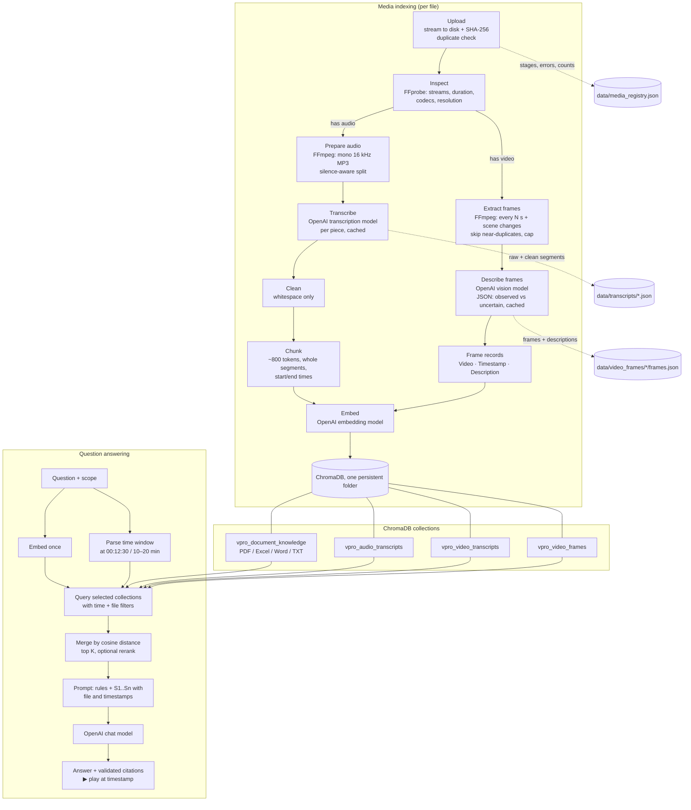

# VPro Skills EduTech — Audio & Video RAG Assistant

Upload recorded classes, meetings and tutorials, then ask questions such as *"At what time did the instructor
explain list comprehensions?"* or *"What code is visible on the screen at 00:12:30?"*. Answers come **only**
from what was actually said (transcripts) and shown (described keyframes) in your recordings, with **file names
and timestamps** you can click to play.

This project extends the VPro **document** RAG assistant (PDF, Excel, Word, TXT). All document features still
work unchanged; their full guide is in [docs/DOCUMENT_RAG.md](docs/DOCUMENT_RAG.md).

**Stack:** Python 3.11+ · Streamlit · OpenAI API (transcription, vision, embeddings, chat) · ChromaDB
(persistent) · FFmpeg/FFprobe · Pillow · tiktoken · pytest

---

## Contents
1. [Quick start](#1-quick-start)
2. [Install FFmpeg](#2-install-ffmpeg)
3. [Walkthrough](#3-walkthrough)
4. [The concepts, in plain English](#4-the-concepts-in-plain-english)
5. [Architecture](#5-architecture)
6. [Timestamps: what each transcription model gives you](#6-timestamps-what-each-transcription-model-gives-you)
7. [ChromaDB design](#7-chromadb-design)
8. [App pages](#8-app-pages)
9. [Project structure](#9-project-structure)
10. [Configuration](#10-configuration)
11. [Reliability, cost and security](#11-reliability-cost-and-security)
12. [Testing](#12-testing)
13. [Troubleshooting](#13-troubleshooting)
14. [Limitations](#14-limitations)

---

## 1. Quick start

```bash
cd RAGS/multimodal-audio
python3 -m venv venv && source venv/bin/activate        # Windows: venv\Scripts\activate
pip install -r requirements.txt
cp .env.example .env                                     # Windows: copy .env.example .env
# edit .env: set OPENAI_API_KEY=sk-...
# install FFmpeg (next section), then:
python scripts/generate_sample_media.py                  # optional: builds two demo recordings
streamlit run app.py
```

Open <http://localhost:8501>. In the sidebar choose **Audio & Video RAG → 🎙️ Audio and Video Upload**, drop in
`sample_files/Python_Lecture.mp4` and `sample_files/RAG_Evaluation_Session.mp3`, and click **Start processing**.

> **API billing:** the OpenAI API is billed separately from ChatGPT plans. Indexing the two demo recordings
> (~2.5 min of audio, 6 described frames) costs a few US cents.

---

## 2. Install FFmpeg

FFmpeg reads, converts and cuts audio/video; FFprobe (installed with it) inspects files. Both must be on your
`PATH` (or set `FFMPEG_BINARY` / `FFPROBE_BINARY` in `.env`).

| OS | Command | Check |
|---|---|---|
| **macOS** | `brew install ffmpeg` (needs [Homebrew](https://brew.sh)) | `ffmpeg -version` |
| **Ubuntu / Debian** | `sudo apt update && sudo apt install ffmpeg` | `ffmpeg -version` |
| **Fedora** | `sudo dnf install ffmpeg` (enable RPM Fusion first) | `ffmpeg -version` |
| **Windows** | `winget install Gyan.FFmpeg` (or download from <https://www.gyan.dev/ffmpeg/builds/>, unzip, add the `bin` folder to *System → Environment Variables → Path*) | open a **new** terminal, `ffmpeg -version` |

The app shows a red "FFmpeg not installed" warning (sidebar and upload page) until it can find both tools.
The demo-media script additionally needs a text-to-speech tool: macOS `say` (built in) or `espeak-ng` on Linux.

---

## 3. Walkthrough

| Step | Where | What you see |
|---|---|---|
| 1. Upload a recording | 🎙️ Audio and Video Upload | file name, size, duration, codec, sample rate (audio) or resolution, frame rate, audio track (video), plus a preview player |
| 2. Choose options | same page | chunk size/overlap, frame interval, max frames, scene-change frames, duplicate skipping, image detail, cache reuse |
| 3. Process | same page | live progress, then the 10-stage pipeline with counts, timings, warnings and errors per file |
| 4. Inspect the transcript | 📝 Transcript Explorer | segments with start/end times, raw vs cleaned text, search, click a row to play from there, chunk boundaries, TXT/SRT download |
| 5. Inspect frames | 🖼️ Video Frame Explorer | each keyframe in time order, its description, what was said around it, its ChromaDB record and vector size |
| 6. Ask questions | 🎬 Audio and Video Chat | grounded answers with `Source: file \| 00:12:15–00:13:05` citations, frame previews and **▶ Play from** buttons |
| 7. See why | 🔬 Retrieval Diagnostics | query embedding size, parsed time filter, every hit with distance/similarity and timestamps, the exact prompt sent to the LLM |
| 8. Manage | 📊 Media Dashboard | totals, statuses, errors, **Retry** (re-uses cached work) and **Delete** (removes everything for that file) |

Restart the app at any time: everything lives in `data/` and is reloaded.

**Example questions:** What topics did the instructor explain in the Python lecture? · At what time did the
instructor explain list comprehensions? · Summarize the lecture between 0 and 1 minutes · Which timestamp
shows the slide explaining ChromaDB? · What code is visible on the screen at 00:00:25? · Compare the
instructor's explanation of chunk overlap with the displayed slide · Which recorded session discusses RAG
evaluation?

Use **Search in** to pick *All indexed sources*, *Documents only*, *Audio only*, *Video only* or *All audio and
video*, and optionally restrict to specific files.

---

## 4. The concepts, in plain English

**Audio transcription.** A speech-to-text model listens to audio and writes down the words. We send the audio to
OpenAI's transcription endpoint in pieces (it accepts at most 25 MB per request) and get text back, sometimes with
the start and end time of each sentence.

**Video audio extraction.** A video file is a container holding separate streams: pictures and sound. FFmpeg can
copy just the sound out into an audio file. That audio then goes through exactly the same transcription
pipeline as an uploaded MP3.

**Keyframe extraction.** A video is a fast series of still pictures (frames), often 30 per second. We do not need
all of them: FFmpeg saves one picture every *N* seconds (default 10), optionally plus the moments where the
picture changes a lot (a new slide). Pictures that look the same as the previous one are skipped.

**Vision-based frame descriptions.** A vision-capable chat model looks at each kept picture and writes what it
sees: the slide title, readable text, code, tables and diagrams, separating what is clearly visible from what it
is unsure about. The picture becomes **text** that we can search.

**Text chunking.** Long transcripts are split into pieces of about 800 tokens (≈600 words). Neighbouring pieces
share ~120 tokens of overlap, so an idea cut at a boundary is still complete in one piece. Transcript chunks are
built from whole transcript segments, so every chunk has a real start and end time.

**Embeddings.** An embedding model turns a text into a list of 1,536 numbers (a vector) that captures its
meaning. Texts with similar meaning get vectors pointing in similar directions. We embed transcript chunks and
frame descriptions with the **same** model as the documents. Important: a frame's vector is the embedding of its
*description*, not of the image itself.

**ChromaDB retrieval.** ChromaDB stores each chunk's text, vector and metadata (file, timestamps, frame path) on
disk. When you ask a question, the question is embedded with the same model and ChromaDB returns the chunks
whose vectors are closest (smallest cosine distance). Timestamps in your question, such as "at 00:12:30" or
"between 10 and 20 minutes", become metadata filters, so the search looks at that moment of the recording.

**LLM answer generation.** The retrieved chunks are placed in a prompt, each labelled `[S1]`, `[S2]`… with its
source and time. The chat model must answer only from them, cite labels after each sentence, and only mention
timestamps that appear in those labels. Labels that do not exist are removed, and if nothing relevant was found
the app says so instead of guessing.

---

## 5. Architecture



---

## 6. Timestamps: what each transcription model gives you

The app asks the configured model only for what it supports and never fabricates the rest. Every segment
records where its timing came from (`timing_source`).

| `OPENAI_TRANSCRIPTION_MODEL` | Request | Timestamps | Speakers | Language |
|---|---|---|---|---|
| `whisper-1` | `verbose_json`, segment granularity | per segment, from the model | — | detected |
| `gpt-4o-transcribe-diarize` | `diarized_json`, `chunking_strategy=auto` | per segment, from the model | **A, B, …** | — |
| `gpt-4o-mini-transcribe`, `gpt-4o-transcribe`, `gpt-transcribe` (default) | `json` | **none returned** | — | — |

**Fallback for text-only models.** Audio is cut into short pieces (`TIMESTAMP_FALLBACK_SECONDS`, default 30 s),
preferably in pauses detected by FFmpeg. Each piece's text gets that piece's real start/end time, marked
`timing_source = audio_split` and shown as **"(approx.)"** in citations. These times are true, but only to the
nearest piece. SRT subtitle export is disabled for such transcripts (TXT is offered), because subtitles need
per-sentence timing. For precise times, use `whisper-1`; for speaker labels, `gpt-4o-transcribe-diarize`.

Inside every transcript chunk the text keeps a `[HH:MM:SS–HH:MM:SS]` marker per segment, so answers can cite a
range narrower than the whole chunk.

---

## 7. ChromaDB design

| Collection | Contents | Key metadata |
|---|---|---|
| `vpro_document_knowledge` | document chunks (unchanged) | `source_file`, `page_number`, `sheet_name`, `row_start/end`, `section_title` |
| `vpro_audio_transcripts` | transcript chunks of audio uploads | `chunk_id`, `document_id`, `media_type=audio`, `source_file`, `chunk_index`, `start_time_seconds`, `end_time_seconds`, `transcript_segment_ids`, `transcription_model`, `timing_source`, `language`, `speakers` |
| `vpro_video_transcripts` | transcript chunks of videos' audio | same as above with `media_type=video_transcript` |
| `vpro_video_frames` | frame descriptions | `chunk_id`, `document_id`, `media_type=video_frame`, `source_file`, `timestamp_seconds`, `span_start/end_seconds`, `frame_path` (relative), `frame_index`, `extraction_method`, `vision_model` |

* All four share one persistent folder (`CHROMA_PERSIST_DIRECTORY`), the cosine metric and the same embedding
  model. Each collection records its model and dimension and refuses vectors from another model.
* **Stable IDs:** media id = `media_` + first 16 hex chars of the file's SHA-256; transcript chunk id =
  media id + position + text hash; frame id = media id + frame index. Re-indexing replaces records instead of
  duplicating them.
* **Transcript ↔ frame link:** both carry the same `document_id` and timeline, so the Frame Explorer shows what
  was said around each frame, and time questions retrieve both.
* **Registry:** `data/media_registry.json` holds one row per recording (status, stages, counts, errors), used
  to list media, show failures, retry, and delete everything for one file.

---

## 8. App pages

| Section | Page | Purpose |
|---|---|---|
| Audio & Video RAG | 📊 Media Dashboard | totals (audio/video files, transcript chunks, frame descriptions, embeddings), last status, errors, retry, delete |
| | 🎙️ Audio and Video Upload | drag-and-drop, FFprobe validation, preview, options, cost estimate, progress, stage report |
| | 📝 Transcript Explorer | full transcript, search, filter by file, jump to timestamp, raw vs cleaned, chunk boundaries, TXT / SRT |
| | 🖼️ Video Frame Explorer | frames in order, descriptions, related transcript, embedding status, ChromaDB record |
| | 🎬 Audio and Video Chat | multimodal chat with timestamped citations and play-at-time |
| | 🔬 Retrieval Diagnostics | query embedding, per-collection search, distances, timestamps, final prompt |
| Document RAG | (unchanged) | Overview, Upload Documents, Indexing Pipeline, Chunk/Embedding/ChromaDB Explorers, Ask, Search |
| System | ⚙️ System Settings | configuration (no secrets), model + FFmpeg checks, rebuild document index, **re-embed all media** |

The ChromaDB Explorer now lets you browse all four collections.

---

## 9. Project structure

New files are marked **new**; everything else is the original document RAG app.

```text
multimodal-audio/
├── app.py                         grouped navigation (Audio & Video / Document / System)
├── config/settings.py             + media settings (models, limits, collections, FFmpeg)
├── backend/
│   ├── media_utils.py        new  FFmpeg runner with timeouts, FFprobe parsing, streaming upload + hash, time formatting
│   ├── audio_processor.py    new  convert to speech MP3, silence detection, cut planning, splitting
│   ├── transcription_service.py new  model capabilities, API calls, response parsing, per-piece failures + cache
│   ├── transcript_cleaner.py new  meaning-preserving cleanup
│   ├── transcript_chunker.py new  timestamped chunks from whole segments
│   ├── transcript_export.py  new  TXT / SRT (SRT only with real timestamps)
│   ├── video_processor.py    new  video summary, audio-track extraction
│   ├── frame_extractor.py    new  frame planning, scene detection, extraction, duplicate skipping
│   ├── frame_analyzer.py     new  vision-model descriptions (observed vs uncertain), cache, failures
│   ├── media_embeddings.py   new  frame records, embedding of transcript/frame records
│   ├── media_vector_store.py new  the three media collections
│   ├── media_registry.py     new  per-recording status, stages and artifacts on disk
│   ├── media_pipeline.py     new  the 10-stage pipeline, partial failure, retry, delete, re-embed
│   ├── media_retrieval.py    new  unified search, time-window filters, merging, citations
│   ├── unified_rag.py        new  multimodal answer rules on top of the RAG chain
│   ├── rag_chain.py               system prompt / not-found message now overridable
│   └── … (document loaders, chunker, embeddings, vector store, retrieval — unchanged)
├── ui/
│   ├── media_components.py   new  stage diagram, players, media citation cards
│   ├── media_dashboard.py · media_upload_page.py · transcript_explorer.py
│   ├── video_frame_explorer.py · media_chat_page.py · media_diagnostics.py   new
│   └── … (document pages; database_explorer.py now has a collection picker)
├── scripts/generate_sample_media.py   new  demo lecture video + meeting audio (TTS + Pillow + FFmpeg)
├── sample_files/                  documents + Python_Lecture.mp4 + RAG_Evaluation_Session.mp3
├── data/                          uploads/, uploads/media/, extracted_audio/, video_frames/, transcripts/, chroma_db/
├── tests/                         test_audio_processor · test_transcription · test_video_processor ·
│                                  test_frame_extractor · test_media_chunking · test_media_retrieval (+ document tests)
└── docs/DOCUMENT_RAG.md           the original document-RAG guide
```

---

## 10. Configuration

All settings are environment variables (see [.env.example](.env.example)). Values are examples, not OpenAI limits.

| Variable | Default | Meaning |
|---|---|---|
| `OPENAI_API_KEY` | — | your API key (never shown or logged) |
| `OPENAI_CHAT_MODEL` / `OPENAI_EMBEDDING_MODEL` | `gpt-4.1-mini` / `text-embedding-3-small` | answers / vectors (shared with documents) |
| `OPENAI_TRANSCRIPTION_MODEL` | `gpt-4o-mini-transcribe` | see section 6 |
| `OPENAI_VISION_MODEL` | `gpt-4.1-mini` | must accept image input |
| `TRANSCRIPTION_LANGUAGE` | blank | ISO-639-1 hint (`en`, `hi`, …) |
| `TRANSCRIPTION_PROMPT` | blank | vocabulary hint, e.g. `VPro Skills, RAG, ChromaDB` (ignored by the diarize model) |
| `AUDIO_CHUNK_SECONDS` | 300 | piece length for models with timestamps |
| `TIMESTAMP_FALLBACK_SECONDS` | 30 | piece length for text-only models (= timestamp precision) |
| `VIDEO_FRAME_INTERVAL_SECONDS` | 10 | default frame interval (adjustable per upload) |
| `MAX_FRAMES_PER_VIDEO` | 500 | hard cap; longer plans are spread evenly |
| `MAX_MEDIA_UPLOAD_SIZE_MB` / `MAX_MEDIA_DURATION_MINUTES` | 200 / 180 | per-file limits (Streamlit's own limit is `maxUploadSize` in `.streamlit/config.toml`) |
| `MEDIA_TOP_K` | 5 | default chunks per answer |
| `CHROMA_PERSIST_DIRECTORY` | `./data/chroma_db` | one folder for all collections |
| `CHROMA_AUDIO_COLLECTION` / `CHROMA_VIDEO_TRANSCRIPT_COLLECTION` / `CHROMA_VIDEO_FRAME_COLLECTION` | `vpro_audio_transcripts` / `vpro_video_transcripts` / `vpro_video_frames` | collection names |
| `FFMPEG_BINARY` / `FFPROBE_BINARY` / `FFMPEG_TIMEOUT_SECONDS` | `ffmpeg` / `ffprobe` / 600 | FFmpeg location and per-command timeout |

If a model name is wrong or not enabled for your project, processing stops with a clear message; the app never
silently switches to another model. **System Settings → Run connection test** checks every configured model.
After changing `OPENAI_EMBEDDING_MODEL`, use **Rebuild index** (documents) and **Re-embed all media**.

---

## 11. Reliability, cost and security

* **Limits:** size checked while streaming the upload to disk (1 MB blocks), duration checked with FFprobe, each
  audio piece checked against the 25 MB transcription limit, frames capped per video.
* **Timeouts:** every FFmpeg/FFprobe call runs as an argument list (no shell) with a timeout.
* **Retries:** transient OpenAI errors (rate limits, timeouts, 5xx) are retried with bounded exponential backoff;
  wrong keys, missing credits or unknown models stop immediately and are not repeated for every piece/frame.
* **Partial failure:** if transcription fails, frames are still indexed (and vice versa); the file is marked
  `partial` with the reason. A silent video is indexed from frames only.
* **Resume, don't repeat:** transcribed pieces and frame descriptions are cached. **Retry** sends only what
  failed; re-indexing unchanged media (e.g. new chunk size) costs only embeddings.
* **Duplicates:** same SHA-256 + same settings = "already indexed". A new version with the same file name
  replaces the old one (optional).
* **Cost controls:** frames every N seconds instead of every frame, near-duplicate frames skipped, `image detail`
  option, max frames, live estimate of audio minutes and frames before you start.
* **Clean-up:** temporary speech audio is deleted after successful transcription; deleting a recording removes
  its ChromaDB records, transcript, frames and original upload.
* **Privacy:** uploads are stored under generated names; media metadata and pages use paths relative to `data/`
  (frame references, audio pieces); the API key never appears in the UI or logs. Audio, frames and text are sent to OpenAI — do not upload confidential
  recordings to this demo.

---

## 12. Testing

```bash
pytest                                   # 147 tests: unit + pipeline tests with real FFmpeg/ChromaDB, fake OpenAI
RUN_OPENAI_INTEGRATION=1 pytest -m integration   # real OpenAI calls (a few cents); run generate_sample_media.py first
```

The media tests build tiny tones and colour-block videos with FFmpeg (skipped automatically if FFmpeg is
missing) and cover: audio/video metadata, silence-aware splitting, timestamp preservation, transcript chunking,
frame extraction and duplicate skipping, stable IDs, duplicate media, ChromaDB storage/deletion/persistence,
retrieval across media types and scopes, time-window filters, citations, missing credentials, unsupported and
corrupted files, and failed transcription / frame analysis with retry.

---

## 13. Troubleshooting

| Symptom | Fix |
|---|---|
| "ffmpeg and ffprobe not found" | install FFmpeg (section 2) and open a new terminal; or set `FFMPEG_BINARY` / `FFPROBE_BINARY` |
| "FFprobe could not read this file" | the file is corrupted or uses a codec your FFmpeg build lacks; re-export it as MP4 (H.264/AAC) or MP3 |
| "No audio or video stream was found" | not a media file, or an empty container |
| Video indexed but no transcript | the video has no audio track (shown as a warning) |
| Timestamps say "(approx.)" | your transcription model returns no timestamps; switch to `whisper-1`, or lower `TIMESTAMP_FALLBACK_SECONDS` |
| "insufficient_quota" | add API credits at platform.openai.com → Billing |
| "model … not found / not allowed" | pick a model your project can use, then **Reload services** in System Settings |
| "cannot be mixed" (embedding model) | you changed `OPENAI_EMBEDDING_MODEL`; run **Re-embed all media** / **Rebuild index** |
| Upload rejected above 200 MB | raise `MAX_MEDIA_UPLOAD_SIZE_MB` **and** `maxUploadSize` in `.streamlit/config.toml` |
| A file stays "processing" | the app was stopped mid-run; open the Media Dashboard and click **Retry** |

---

## 14. Limitations

* Frame descriptions cover only the sampled frames, and a vision model can misread small text or code; the
  description marks what it was unsure about. Vectors are text embeddings of those descriptions.
* With text-only transcription models, times are accurate only to the audio piece (default 30 s).
* Speaker labels exist only with the diarization model; they are letters (A, B…), not real names.
* Transcription quality depends on audio quality, accents and domain terms (`TRANSCRIPTION_PROMPT` helps).
* This is a single-user local demo: no authentication, per-user isolation, malware scanning or background
  job queue. Long recordings are processed inside the Streamlit request, so keep the browser tab open.
