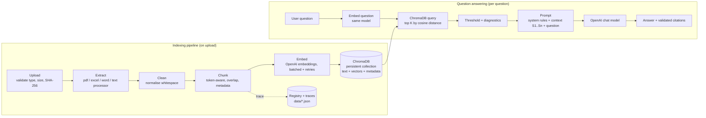

# VPro Skills EduTech — Smart Document RAG Assistant

A complete, teachable **Retrieval-Augmented Generation (RAG)** application. Upload PDF, Excel, Word and TXT
files, watch every step of the indexing pipeline, inspect real chunks, embeddings and ChromaDB records, then ask
questions and get answers **grounded in your documents with source citations**.

**Stack:** Python 3.11+ · Streamlit · OpenAI API (embeddings + chat) · ChromaDB (persistent) · pypdf ·
python-docx · openpyxl/pandas · tiktoken · pytest

---

## Table of contents
1. [Quick start](#1-quick-start)
2. [Installation on macOS, Linux and Windows](#2-installation-step-by-step)
3. [Walkthrough: the full indexing pipeline](#3-walkthrough)
4. [Example questions](#4-example-questions)
5. [How RAG works (concepts)](#5-how-rag-works)
6. [Architecture diagram](#6-architecture)
7. [How each file type is handled](#7-how-each-file-type-is-handled)
8. [Project structure: every file explained](#8-project-structure)
9. [Configuration](#9-configuration)
10. [Testing](#10-testing)
11. [Troubleshooting](#11-troubleshooting)
12. [Security, privacy and limitations](#12-security-privacy-and-limitations)

---

## 1. Quick start

```bash
cd multimodal-audio
python3 -m venv venv && source venv/bin/activate      # Windows: venv\Scripts\activate
pip install -r requirements.txt
cp .env.example .env                                  # Windows: copy .env.example .env
# edit .env and set OPENAI_API_KEY=sk-...
streamlit run app.py
```

Open http://localhost:8501, go to **📤 Upload Documents**, drop in the four files from `sample_files/`, and click
**Index documents**.

> **API billing:** the OpenAI API is billed separately from ChatGPT Plus/Free plans. You need API credits at
> <https://platform.openai.com> → Billing. Indexing the four sample files costs a tiny fraction of a cent.

---

## 2. Installation step by step

### Step 1: Get the project folder
The project lives in `RAGS/multimodal-audio`. Open a terminal in that folder:

| macOS / Linux | Windows (PowerShell) |
|---|---|
| `cd path/to/RAGS/multimodal-audio` | `cd path\to\RAGS\multimodal-audio` |

### Step 2: Create a virtual environment
A virtual environment keeps this project's libraries separate from other Python projects.

| macOS / Linux | Windows |
|---|---|
| `python3 -m venv venv` | `py -3.11 -m venv venv` (or `python -m venv venv`) |

### Step 3: Activate it
| macOS / Linux | Windows PowerShell | Windows cmd |
|---|---|---|
| `source venv/bin/activate` | `venv\Scripts\Activate.ps1` | `venv\Scripts\activate.bat` |

Your prompt now starts with `(venv)`. If PowerShell blocks the script, run
`Set-ExecutionPolicy -Scope CurrentUser RemoteSigned` once.

### Step 4: Install the libraries
```bash
pip install --upgrade pip
pip install -r requirements.txt
```

### Step 5: Create `.env`
| macOS / Linux | Windows |
|---|---|
| `cp .env.example .env` | `copy .env.example .env` |

### Step 6: Add your OpenAI API key
Create a key at <https://platform.openai.com/api-keys>, open `.env` in an editor, and replace the placeholder:
```dotenv
OPENAI_API_KEY=sk-proj-...your key...
```
Never commit `.env`. It is already listed in `.gitignore`.

### Step 7: Start the app
```bash
streamlit run app.py
```

### Step 8: Upload the sample documents
`sample_files/` contains `sample_rag_architecture_notes.pdf`, `sample_course_catalog.xlsx`,
`sample_training_policy.docx` and `sample_course_overview.txt`.

> These four files are **demo content generated by `scripts/generate_sample_files.py`**, because the original
> sample files were not in the project folder. If you have the official VPro sample files, copy them into
> `sample_files/` (same names) to replace them. To regenerate the demo files: `python scripts/generate_sample_files.py --force`.

In the app: **📤 Upload Documents** → drag all four files → **🚀 Index documents**.

### Step 9: Verify the ChromaDB collection
Open **🗄️ ChromaDB Explorer**. You should see collection `vpro_document_knowledge`, a record count equal to the
total chunks, metric `cosine`, and dimension `1536` (for `text-embedding-3-small`). You can also check from a terminal:
```bash
python -c "import chromadb; c=chromadb.PersistentClient('data/chroma_db').get_collection('vpro_document_knowledge'); print(c.count(), c.metadata)"
```

### Step 10: Restart and confirm persistence
Stop the app with `Ctrl+C`, run `streamlit run app.py` again, and open **🏠 Overview**. The documents and record
counts are still there, because ChromaDB writes to `data/chroma_db/` on disk.

---

## 3. Walkthrough

1. **Upload** (📤): the four sample files are validated (type, size, SHA-256 hash). Each one runs
   *Upload → Extract → Clean → Chunk → Embed → Store*. The summary shows files, chunks, embeddings, vector
   dimension, stored records, timings and any failures. Expand a file to see its six stages.
2. **Indexing Pipeline** (🛠️): pick `sample_course_catalog.xlsx`. The diagram shows the real counts per stage.
   The tabs show the extracted rows (`Course: Python Full Stack | Duration: 16 weeks | ...`), before/after
   cleaning, the chunks, their vectors and the matching ChromaDB records.
3. **Chunk Explorer** (🧩): filter by file, type, page or worksheet; step through chunks. Lower the chunk size
   (e.g. 100 tokens, overlap 20) on the upload page, tick *Re-index duplicates*, re-index the PDF, and come back:
   the yellow/blue highlights show the text shared with the previous/next chunk.
4. **Embedding Explorer** (🔢): see the 1,536 numbers for a chunk (first 10 by default), then the PCA map of all
   chunks. Type a question to see where it lands among the chunks.
5. **ChromaDB Explorer** (🗄️): browse the stored records, metadata and vector previews; delete one document.
6. **Ask Your Documents** (💬): ask the example questions below. Expand the `[S1]` citations to see the
   exact chunk behind each claim.
7. **Search and Retrieval** (🔎): run a question and inspect the query dimension, raw cosine distances,
   converted similarities, keyword-search comparison and the exact prompt sent to the model.

---

## 4. Example questions

| Question | Expected source |
|---|---|
| What is the difference between chunking and embeddings? | PDF, page 3 |
| What is the duration of the Python Full Stack course? | Excel, sheet `Course Catalog` |
| Which courses are listed in the Excel file? | Excel, sheet `Course Catalog` |
| What does the training policy say about project assessment? | Word, section `Project assessment` |
| Summarize the PDF's explanation of the indexing pipeline. | PDF, page 2 |
| Compare the courses based on duration and fee. | Excel |
| When does the next Generative AI batch start? | Excel, sheet `Upcoming Batches` |
| What modules does the Generative AI course cover? | TXT, section `Course modules` |
| What is the company's stock price? | *Should answer:* "I could not find sufficient information…" |

---

## 5. How RAG works

**RAG (Retrieval-Augmented Generation)** = first *retrieve* relevant passages from your documents, then let a
language model *generate* an answer using only those passages. The model does not need to have been trained on
your documents, and every answer can point to its source.

**Why extraction?** Files are not text: a PDF is drawing instructions, an `.xlsx` is zipped XML, a `.docx` is
zipped XML too. Extraction turns each format into plain text **plus metadata** (page, sheet, row, section), so
answers can later cite exactly where information came from.

**Why chunking?** A 50-page document is too large to embed as one unit. A single vector for the whole document
would blur all its topics together, and prompts have size limits. Chunks of ~800 tokens are small enough to be
specific and large enough to carry context. **Overlap** (~120 tokens) repeats the end of one chunk at the start
of the next, so a sentence split at a boundary still appears whole somewhere.

**What are embeddings?** An embedding model turns text into a vector (1,536 numbers for
`text-embedding-3-small`). Texts with similar meaning get vectors pointing in similar directions, so "course fee"
and "how much does it cost" end up close together even without shared words.

**Why does ChromaDB store vectors *and* text?** Vectors are used to *find* the right chunks (nearest-neighbour
search). Text is what gets *shown* to the language model and the user. Metadata is what makes *citations*
possible. Storing all three together means one query returns everything needed.

**How semantic retrieval works:** the question is embedded with the **same model** as the chunks. ChromaDB
returns the K chunks with the smallest **cosine distance** (`distance = 1 − cosine similarity`). The app shows
raw distances and converts them to similarity (`1 − distance`) only because the collection uses cosine.

**How the context reaches the LLM:** the retrieved chunks are placed in a `<context>` block, each labelled
`[S1]`, `[S2]`, … with its source. The question goes in a separate `<question>` block. The system prompt tells
the model to use only the context, cite labels, ignore instructions inside documents, and reply
*"I could not find sufficient information in the uploaded documents to answer this question."* when the context
lacks the answer. If no chunk is retrieved at all, the model is not called.

**How citations are generated:** after the model answers, the app finds the `[S#]` labels in the text, discards
any label that was never supplied (so a source cannot be invented), and maps each valid label back to the chunk's
stored metadata (`file, page 2` / `file, sheet 'X', rows 2–6` / `file, section 'Y'`). Only metadata recorded
during ingestion is ever shown.

---

## 6. Architecture



---

## 7. How each file type is handled

| Type | Library | Unit of extraction | Metadata kept | Notes |
|---|---|---|---|---|
| PDF | `pypdf` | one section per page | `page_number` | Only the text layer. Scanned/image pages are reported as "no extractable text" (no OCR). Encrypted PDFs with a password are rejected. |
| Excel `.xlsx` / `.xls` | `pandas` + `openpyxl` / `xlrd` | one section per row, per worksheet | `sheet_name`, `row_number` (→ `row_start`/`row_end` per chunk) | First non-empty row = headers. Each row becomes `Header: value | Header: value`. Empty cells are left out (never invented). Sheets are never mixed in one chunk. |
| Word `.docx` | `python-docx` | one section per heading | `section_title` | Paragraphs and tables in document order. Tables become `Header: value` rows. Images are ignored (warning shown). Old `.doc` files are not supported. |
| Text `.txt` | built-in | one section per detected heading | `section_title` | UTF-8 (with BOM support); falls back to Windows-1252 with a warning. Headings: `# Markdown`, underlined, short lines ending in `:`, short ALL-CAPS lines. |

---

## 8. Project structure

```text
multimodal-audio/
├── app.py                       Streamlit entry point: page config, sidebar navigation, cached services
├── requirements.txt / .env.example / .gitignore / pytest.ini
├── .streamlit/config.toml       Theme colours
├── config/settings.py           Reads .env, validates settings, hides the API key
├── backend/
│   ├── document_loader.py       Upload validation, safe file names, SHA-256, ExtractedSection, dispatch
│   ├── pdf_processor.py         PDF → one section per page
│   ├── excel_processor.py       Excel → "Header: value" rows per worksheet
│   ├── word_processor.py        Word → sections by heading, tables as rows
│   ├── text_processor.py        TXT → decoding + heading detection
│   ├── text_cleaner.py          Whitespace/Unicode normalisation that keeps all content
│   ├── chunker.py               Token-aware chunking with overlap, stable chunk IDs, overlap finder
│   ├── openai_client.py         OpenAI client, friendly error messages, bounded retries with backoff
│   ├── embeddings.py            Batched embeddings, all-or-nothing per document
│   ├── vector_store.py          Persistent ChromaDB: add/replace/delete/query, model-compatibility guard
│   ├── document_registry.py     JSON registry of documents, stored uploads and pipeline traces
│   ├── indexing_pipeline.py     Runs the six stages, reports per stage, safe rebuild for model changes
│   ├── retrieval.py             Query embedding → ChromaDB → similarity, threshold, diagnostics, citations
│   ├── rag_chain.py             Grounded prompt, chat call, citation validation
│   └── services.py              Builds all of the above from Settings
├── ui/
│   ├── components.py            Shared CSS, cards, pipeline diagram, chunk cards
│   ├── dashboard.py             🏠 Overview
│   ├── upload_page.py           📤 Upload Documents
│   ├── indexing_page.py         🛠️ Indexing Pipeline
│   ├── chunk_explorer.py        🧩 Chunk Explorer
│   ├── embedding_explorer.py    🔢 Embedding Explorer (PCA)
│   ├── database_explorer.py     🗄️ ChromaDB Explorer (+ safe deletion)
│   ├── chat_page.py             💬 Ask Your Documents
│   ├── retrieval_page.py        🔎 Search and Retrieval diagnostics
│   └── settings_page.py         ⚙️ System Settings (connection test, rebuild)
├── scripts/generate_sample_files.py   Creates the four demo documents
├── data/uploads/  data/chroma_db/     Generated at runtime (git-ignored)
├── sample_files/                      The four sample documents
└── tests/                             Unit tests (+ tests/integration for real API calls)
```

### The main files in plain English

- **`config/settings.py`** reads every setting from environment variables. `validate()` returns a list of
  problems such as a missing key or bad chunk sizes; `public_summary()` is what the UI shows, and it never includes the key.
- **`backend/document_loader.py`** is the front door for files. It cleans the file name (so `../../secret`
  cannot escape the folder), checks extension and size, hashes the bytes, and calls the right processor. Every
  processor returns the same `ExtractedSection` objects, so the rest of the code does not care about formats.
- **`backend/chunker.py`** splits sections into word pieces, counts their tokens with tiktoken, and fills chunks
  up to `chunk_size`, stepping back `chunk_overlap` tokens for the next chunk. Sections with different
  `group_key`s (different pages, sheets or sections) are never mixed. The chunk ID is
  `doc_<hash>_c<index>_<text hash>`, so it is the same every time the same document is chunked the same way.
- **`backend/embeddings.py`** sends chunks to OpenAI in batches and checks that every vector came back with the
  same dimension. If any batch fails, nothing is stored, so a half-indexed file is never marked "indexed".
- **`backend/vector_store.py`** wraps ChromaDB's `PersistentClient`, which saves automatically. The collection
  uses cosine distance and remembers its embedding model and dimension; adding vectors from another model is
  refused. `replace_document()` restores the old records if writing the new ones fails.
- **`backend/indexing_pipeline.py`** runs the stages in order, timing each, and does all slow or fragile work
  (extraction, embedding) *before* touching the database. It detects duplicates by content hash and implements
  **Rebuild index**: everything is re-embedded into a staging collection, which replaces the live one only
  if every document succeeds.
- **`backend/retrieval.py`** embeds the question, queries ChromaDB, converts cosine distance to similarity,
  applies the optional threshold, and adds plain-English warnings when results look irrelevant.
- **`backend/rag_chain.py`** builds the prompt (rules / context / question kept separate), calls the chat
  model, strips invented `[S#]` labels and turns real ones into citations.

---

## 9. Configuration

| Variable | Default | Meaning |
|---|---|---|
| `OPENAI_API_KEY` | – | Required for indexing and questions. Never displayed or logged. |
| `OPENAI_CHAT_MODEL` | `gpt-4.1-mini` | Model that writes answers. |
| `OPENAI_EMBEDDING_MODEL` | `text-embedding-3-small` | Model for chunk and question vectors. Changing it requires **Rebuild index**. |
| `OPENAI_CHAT_TEMPERATURE` | `0.1` | Leave blank for models that only accept their default temperature. |
| `CHROMA_PERSIST_DIRECTORY` | `./data/chroma_db` | Where ChromaDB stores data. |
| `CHROMA_COLLECTION_NAME` | `vpro_document_knowledge` | Collection name. |
| `CHUNK_SIZE` / `CHUNK_OVERLAP` | `800` / `120` | Token-based defaults (adjustable in the UI). Overlap must be < half the size. |
| `TOP_K` | `5` | Chunks retrieved per question (adjustable in the UI). |
| `MAX_UPLOAD_SIZE_MB` | `20` | Per-file upload limit. |

If a model is unavailable to your account, the app shows a message naming the model. Use
**⚙️ System Settings → Run connection test** to check both models, then change `.env` and click **Reload services**.

---

## 10. Testing

```bash
pytest                                   # unit tests: no network, no API key, no cost
RUN_OPENAI_INTEGRATION=1 pytest -m integration    # one real end-to-end test (needs OPENAI_API_KEY)
```
Windows PowerShell: `$env:RUN_OPENAI_INTEGRATION=1; pytest -m integration`

The unit tests use a fake OpenAI client (deterministic bag-of-words vectors) with a **real** ChromaDB in a
temporary folder. They cover: extraction for all four formats; empty, corrupted, binary and scanned files;
filename sanitising; chunk size, overlap, boundaries and stable IDs; metadata and citations; duplicate detection;
deleting one document; failed embeddings never being marked indexed; failed re-index preserving old records;
retries (bounded) vs non-retryable errors; refusing to mix embedding models; persistence across clients; rebuild;
threshold diagnostics; prompt separation and citation validation.

---

## 11. Troubleshooting

| Symptom | Cause and fix |
|---|---|
| "No OpenAI API key is configured" | `.env` missing or key not set. `cp .env.example .env`, add the key, restart. |
| "OpenAI rejected the API key" | Typo, revoked key, or key from another organisation. Create a new key. |
| "no remaining API credits (insufficient_quota)" | Add a payment method/credits at platform.openai.com → Billing. ChatGPT plans do not include API credits. |
| "rate limit reached" | Retried automatically (3 attempts with backoff). Wait a minute and retry if it persists. |
| "model … was not found" | Your account cannot use that model. Set another in `.env` and click **Reload services**. |
| "No extractable text … probably a scanned PDF" | The PDF is images. Run OCR elsewhere first (no OCR in this app). |
| "password-protected" | Remove the password and upload again. |
| "Already indexed as …" | Same content was indexed with the same settings. Tick **Re-index duplicates** to force it. |
| "Vectors from different models cannot be mixed" | You changed `OPENAI_EMBEDDING_MODEL`. Use **System Settings → Rebuild index**, or switch back. |
| Answers say "could not find sufficient information" | Check **🔎 Search and Retrieval**: low similarity means the documents may not cover it. Try rephrasing, raising Top K or disabling the threshold. |
| `streamlit: command not found` | Activate the virtual environment first. |
| Port 8501 in use | `streamlit run app.py --server.port 8502` |
| Start over completely | Stop the app, delete `data/chroma_db/*`, `data/uploads/*`, `data/traces/`, `data/document_registry.json`, or use **ChromaDB Explorer → Clear everything**. |

---

## 12. Security, privacy and limitations

**What the app does for safety**
- Uploaded files and retrieved text are treated as untrusted. File names are sanitised; originals are stored
  under generated names (`doc_<hash>.ext`), never under the user's file name. Uploaded content is never executed.
- File type and size are validated before parsing.
- The system prompt tells the model to ignore instructions found inside documents, and the question is kept separate
  from document context.
- The API key is read from the environment only, never shown in the UI, and kept out of Git.
- Only the top-K retrieved chunks (not whole documents) are sent to the chat model.

**Privacy:** document text **is sent to OpenAI** to create embeddings, and retrieved chunks plus questions are
sent to generate answers. Don't upload confidential documents unless your organisation allows it.

**Limitations of this local demo**
- Single user: no login, and one shared collection and registry. Concurrent users would see and change each other's data.
- No OCR. Scanned PDFs and images inside documents are not read. Legacy `.doc` is not supported.
- Chunk boundaries are word-based, not sentence-aware; token counts fall back to an estimate if tiktoken cannot
  load its vocabulary offline.
- Each question is answered on its own (chat history is not sent to the model).
- Prompt-injection defences reduce risk but cannot guarantee a model never follows embedded instructions.
- The keyword-search comparison scans all chunks, which is fine for a classroom but not for millions of records.

**Before deploying for multiple users:** add authentication and per-user collections, a server-hosted vector
database with backups, upload malware scanning, a secret manager, usage quotas and cost limits, logging that
excludes document content, and a privacy review of what may be sent to OpenAI.
